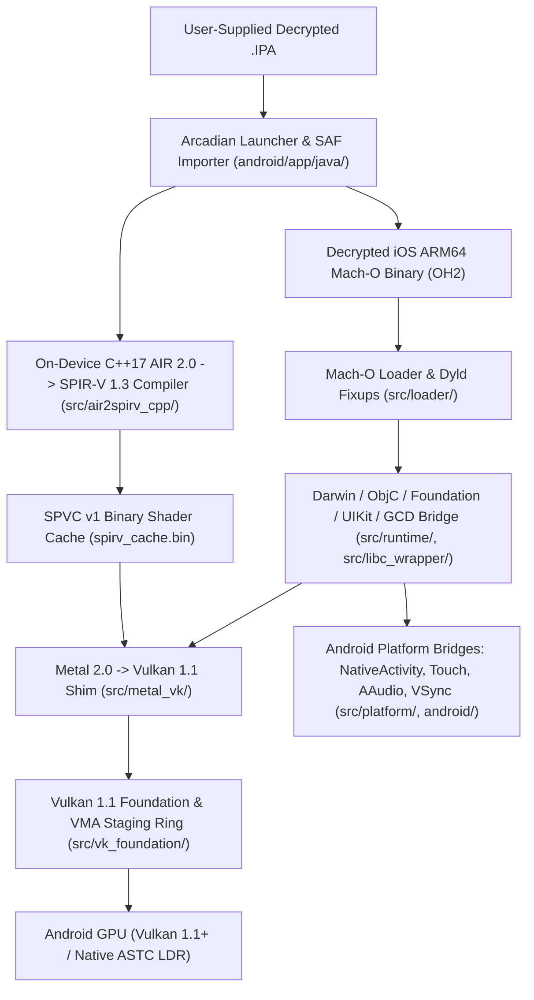

# OH2Recomp — Oceanhorn 2 Android Vulkan Runtime & Standalone Launcher

[-3DDC84?logo=android&logoColor=white)](https://github.com/HanVian-06/OH2Recomp)
[](https://github.com/HanVian-06/OH2Recomp)
[](docs/analysis/shaders_air.md)
[](LICENSE)

**OH2Recomp** is an open-source native compatibility runtime, ARM64 Mach-O loader, **on-device C++17 Apple AIR 2.0 → SPIR-V 1.3 shader compiler**, Metal 2.0 → Vulkan 1.1 translation layer, and Arcadian-themed Android Launcher that runs the decrypted iOS ARM64 binary of **Oceanhorn 2: Knights of the Lost Realm** (Unreal Engine 4.23) natively on Android ARM64 devices.

> [!IMPORTANT]
> **Legal & Asset Notice:** This repository and its Release APKs contain **zero copyrighted game files, binaries, icons, textures, audio, or shaders**. Users must supply their own legally obtained, decrypted Oceanhorn 2 iOS `.ipa` (`LC_ENCRYPTION_INFO_64.cryptid == 0`) via the in-app **IMPORT .IPA** launcher.

---

## End-User Installation (No PC Required)

1. Download and install **`oh2_android-release.apk`** (~2.7 MB) from [**GitHub Releases**](https://github.com/HanVian-06/OH2Recomp/releases) on an Android ARM64 device:
   - **Minimum Specs:** `arm64-v8a`, Android 10+ (API 29+), 6 GB+ RAM, Vulkan 1.1+ GPU with hardware **ASTC LDR** support.
2. Open **Oceanhorn 2** to launch the **Arcadian Launcher**.
3. Tap **IMPORT .IPA** and select your legally obtained, decrypted Oceanhorn 2 `.ipa`.
4. The Launcher automatically:
   - Streams and extracts `OH2` and `cookeddata/` from the `.ipa` into app storage,
   - Verifies the ARM64 Mach-O header (`cryptid == 0`),
   - Compiles all **4,544 AIR 2.0 shaders** (**4,482 unique MTLB modules**) directly on-device into a Vulkan 1.1 `SPVC v1` binary cache (`~3 seconds` across multi-threaded workers).
5. Tap **PLAY OCEANHORN 2**!

---

## Architecture Overview



## Key Technical Highlights

- **Headless Mach-O ARM64 Runtime Loader (`src/loader/`)**:
  - Parses `MH_MAGIC_64` segments (`__TEXT`, `__DATA`, `__LINKEDIT`), applies **520,119** `LC_DYLD_INFO_ONLY` rebase/bind fixups, resolves all **805** undefined Darwin/ObjC/C++ symbols (including Darwin-to-AAPCS64 variadic trampolines), and synthesizes ARM64 DWARF `.eh_frame` unwind tables from `__unwind_info`.
- **Darwin, Objective-C & Foundation Runtime (`src/runtime/`, `src/libc_wrapper/`)**:
  - Lock-free fast-cached ARM64 `objc_msgSend` / `objc_msgSendSuper2` dispatch (`objc_msgSend_arm64.S`), ARC retain/release/`dealloc` + zero-alloc `NSAutoreleasePool`, Apple Blocks (`_Block_copy`/`_Block_release`), libdispatch GCD queues/semaphores, `NSThread`/`NSRunLoop`/`NSCondition`/`NSData`/`NSString`/`UIKit` bridges, and Darwin-to-Bionic POSIX shims (`errno`, `stat64`, `dirent64`, `pthread`, `sysctl`, `mmap`/`vm_allocate`).
  - Automatic big-core CPU affinity (`Cortex-A720`) and priority tuning for UE4 `GameThread`, `RenderThread`, `RHIThread`, `TaskGraph`, and `AChoreographer`.
- **On-Device C++17 AIR 2.0 → SPIR-V 1.3 Shader Compiler (`src/air2spirv_cpp/` & `tools/air2spirv/`)**:
  - Parses UE4 PAK v8 shader archives (`ShaderArchive-Global-SF_METAL.ushaderbytecode` and `ShaderArchive-OH2-SF_METAL.ushaderbytecode`) and compiles all **4,544 shaders** (**4,482 unique MTLB bitcode modules**) to Vulkan 1.1 SPIR-V 1.3 directly on Android in ~3 seconds.
  - **4,544 / 4,544 (100.00%)** pass `spirv-val --target-env vulkan1.1` with byte-identical `SPVC v1` output vs the offline Python reference compiler.
  - Full lowering for Apple programmable blending / framebuffer fetch (`air.render_target` → `OpImageFetch` with RGB vs depth-only `.a` tracking), vector float/integer conversions (`air.convert.f.v*` for accurate CSM shadow cascades), `air.gather_texture_2d`, explicit `Lod`/`Bias`/`ConstOffset` sampling, and collision-free Vulkan 1.1 `Location 0..15` stage I/O mapping.
- **Metal 2.0 → Vulkan 1.1 Shim (`src/metal_vk/`, `src/vk_foundation/`)**:
  - Zero-copy hardware **ASTC LDR/sRGB** texture passthrough across all Apple `MTLPixelFormatASTC_*` block sizes.
  - `VK_KHR_dynamic_rendering` (with `VkRenderPass` fallback), `VK_DESCRIPTOR_TYPE_UNIFORM_BUFFER_DYNAMIC`, persistent cross-frame descriptor set caching, bucketed `MTLBuffer` recycling pool (`4 KiB..1 MiB`), persistent multi-resolution/format `fb_fetch` snapshot pool, cached subresource attachment `VkImageView`s, on-demand GPU-preamble DMA (`slot.preamble_cmd`) for buffer-backed textures, hardware occlusion queries, persistent `VkPipelineCache`, and Android ADPF performance hint integration.
- **Android Platform Integration (`src/platform/`, `android/`)**:
  - `ANativeActivity` lifecycle with sticky immersive fullscreen, Back-key swallowing, and Home/Recents state preservation.
  - `AU3DMixerEmbedded` / CoreAudio → **AAudio** low-latency stereo mixer with automatic focus/lifecycle pause & resume.
  - Crystal-locked `AChoreographer` → `CADisplayLink` hardware VSync divider supporting both **30 FPS** (60 FPS OFF) and **60 FPS** (60 FPS ON) in-game modes across 60/90/120 Hz displays, plus full multi-touch `UIEvent` / `UITouch` translation.

### Reference Device Target

Verified on **Samsung Galaxy A56 (`SM-A566B`)** — Exynos 1580 (`s5e8855`) / Samsung Xclipse 540 GPU (Vulkan 1.3, hardware ASTC LDR, Android `arm64-v8a`). Other chipsets (Adreno / Mali / Immortalis) are structurally supported via standard Vulkan 1.1 + ASTC LDR (`belum teruji` until community-verified).

---

## Repository Structure

| Path | Description |
|---|---|
| `src/loader/` | Mach-O ARM64 loader, dyld fixups, 805-symbol resolver, variadic trampolines, ARM64 unwind bridge |
| `src/libc_wrapper/` | Darwin ↔ Android Bionic POSIX ABI shims (`errno`, `stat`, `fcntl`, `socket`, `mmap`, `pthread`) |
| `src/runtime/` | Objective-C runtime (`objc_msgSend_arm64.S`), Foundation, UIKit, `CADisplayLink`, GCD & Blocks |
| `src/vk_foundation/` | Standalone Vulkan 1.1 context, swapchain, VMA allocator, 64 MiB staging ring, ASTC upload |
| `src/metal_vk/` | Metal 2.0 → Vulkan 1.1 device, resources, pipelines, command encoders, and `SPVC v1` cache loader |
| `src/platform/` | Android NativeActivity bridges (AAudio mixer, multi-touch input, Choreographer VSync) |
| `src/air2spirv_cpp/` | Native C++17 UE4 PAK v8 reader, AIR 2.0 → SPIR-V 1.3 compiler, and `SPVC v1` binary packer |
| `tools/air2spirv/` | Offline Python reference AIR 2.0 → SPIR-V 1.3 translator & `spirv-val` test suite |
| `android/` | Standalone Arcadian Launcher (`java/`), JNI bridge, NativeActivity entry, manifest & CMake |
| `scripts/` | Portable environment setup (`env.ps1`), APK packager, and milestone gates (`gate_m0.py` .. `gate_m5.ps1`) |
| `docs/` | Architecture plan, ADRs/decisions, chronological progress log, and Mach-O/ObjC/AIR/PAK analysis |
| `third_party/` | Vendored Vulkan Memory Allocator (VMA) & Khronos Vulkan Validation Layer (`arm64-v8a`) |

---

## Prerequisites (Building from Source)

- **OS:** Windows 10/11 (PowerShell 5.1+ / PowerShell 7)
- **Android SDK & NDK:** Android SDK (`platform-tools`, `build-tools` 35/36, `cmake` 3.22.1+) and Android NDK r28+ (`28.2.13676358` recommended)
- **JDK:** JDK 11+ (`javac`, `java` on `PATH` or `JAVA_HOME`)
- **Vulkan SDK:** 1.3/1.4+ (`spirv-val`, `glslc` — required only for offline shader/sandbox gates)
- **Python:** 3.10+

---

## Quick Start (Build from Source)

1. **Clone the repository:**
   ```powershell
   git clone https://github.com/HanVian-06/OH2Recomp.git
   cd OH2Recomp
   ```
   `scripts/env.ps1` automatically detects `ANDROID_HOME` / `%LOCALAPPDATA%\Android\Sdk`, installed NDK/CMake versions, and `VULKAN_SDK`. To override paths locally without modifying tracked files, create `scripts/env.local.ps1` (git-ignored).

2. **Build the Clean Open-Source Release APK (No Game Assets Required):**
   ```powershell
   powershell -ExecutionPolicy Bypass -File scripts/gate_m5.ps1 -Release -BuildOnly
   ```
   Outputs the signed, stripped, 16 KiB-aligned asset-free APK at `build/m5/oh2_android-release.apk` (~2.7 MB). Install via:
   ```powershell
   adb install -r build/m5/oh2_android-release.apk
   ```

3. **Developer Verification Gates (optional):**
   ```powershell
   # Gate M0: Verify repository structure & documentation metrics
   python scripts/gate_m0.py

   # Gate M4: Offline Python AIR -> SPIR-V validation (requires local Payload/OH2.app/)
   powershell -ExecutionPolicy Bypass -File scripts/gate_m4.ps1 -Workers 8

   # Gate M5: Debug APK build (with Khronos validation layer when local Payload/OH2.app/ is present)
   powershell -ExecutionPolicy Bypass -File scripts/gate_m5.ps1 -BuildOnly
   ```

---

## Documentation

- [docs/PLAN.md](docs/PLAN.md) — Milestone roadmap & acceptance criteria
- [docs/DECISIONS.md](docs/DECISIONS.md) — Architectural decision records (ADRs) & root-cause notes
- [docs/PROGRESS.md](docs/PROGRESS.md) — Chronological engineering progress log
- [docs/BLOCKERS.md](docs/BLOCKERS.md) — Active blocker tracker
- [docs/analysis/macho_binary.md](docs/analysis/macho_binary.md) — Mach-O ARM64 binary & symbol analysis
- [docs/analysis/objc_metadata.md](docs/analysis/objc_metadata.md) — Objective-C classes & selectors
- [docs/analysis/shaders_air.md](docs/analysis/shaders_air.md) — AIR 2.0 bitcode shader archive analysis
- [docs/analysis/pak_textures_audio.md](docs/analysis/pak_textures_audio.md) — UE4 PAK v8, ASTC texture & audio analysis
- [docs/analysis/toolchain_device.md](docs/analysis/toolchain_device.md) — Toolchain & reference device capabilities

---

## Contributing

Contributions, device compatibility reports, and pull requests are welcome! Please read [CONTRIBUTING.md](CONTRIBUTING.md) before submitting changes.

---

## License

Original source code in this repository is licensed under the [MIT License](LICENSE).
Third-party components under `third_party/` remain under their respective licenses.
*Oceanhorn 2: Knights of the Lost Realm* is a trademark of Cornfox & Bros. Ltd.; this project is an independent, non-commercial compatibility runtime research project and is not affiliated with or endorsed by Cornfox & Bros. Ltd. or Apple Inc.
