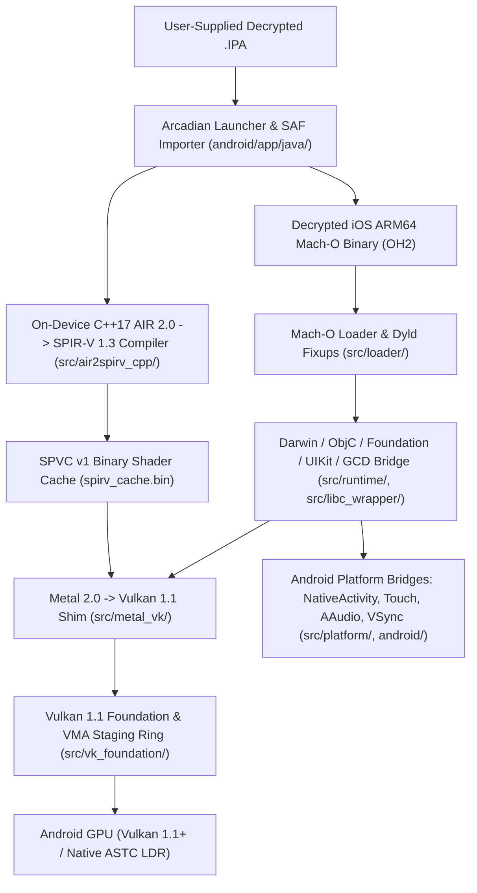

# OH2Recomp — Oceanhorn 2 Android Vulkan Runtime & Standalone Launcher

[-3DDC84?logo=android&logoColor=white)](https://github.com/HanVian-06/OH2Recomp)
[](https://github.com/HanVian-06/OH2Recomp)
[](docs/analysis/shaders_air.md)
[](LICENSE)

An open-source native compatibility runtime, Mach-O ARM64 loader, **on-device C++17 Apple AIR 2.0 → SPIR-V 1.3 shader compiler**, Metal 2.0 → Vulkan 1.1 shim, and Arcadian-themed Android Launcher that runs the iOS ARM64 binary of **Oceanhorn 2: Knights of the Lost Realm** (Unreal Engine 4) natively on Android ARM64 devices with Vulkan 1.1+.

> [!IMPORTANT]
> **Legal & Asset Notice:** This repository and its Release APKs contain **zero copyrighted game files, binaries, icons, textures, audio, or shaders**. Users must supply their own legally obtained, decrypted Oceanhorn 2 iOS `.ipa` (`cryptid == 0`) via the in-app **IMPORT .IPA** launcher.

---

## End-User Installation (No PC Required)

1. Download and install the clean open-source **`oh2_android-release.apk`** (~2.6 MB) from [**GitHub Releases**](https://github.com/HanVian-06/OH2Recomp/releases) on an Android ARM64 device (Android 10+, Vulkan 1.1+, hardware ASTC LDR).
2. Open **Oceanhorn 2** to enter the Arcadian Launcher.
3. Tap **IMPORT .IPA** and pick your legally obtained, decrypted Oceanhorn 2 `.ipa`.
4. The Launcher automatically:
   - Streams and extracts `OH2` + `cookeddata/` from the `.ipa` into app storage,
   - Verifies the ARM64 Mach-O header (`cryptid == 0`),
   - Compiles all **4,544 AIR 2.0 shaders** directly on-device into a Vulkan 1.1 `SPVC v1` cache (`~3 seconds` on modern ARM64 phones).
5. Tap **PLAY OCEANHORN 2**!

---

## Architecture Overview



## Key Technical Highlights

- **Headless Mach-O ARM64 Runtime Loader (`src/loader/`)**: Parses `MH_MAGIC_64` segments, applies 520,119 dyld rebase/bind fixups, resolves 805 undefined Darwin/ObjC/C++ symbols, and synthesizes ARM64 `.eh_frame` unwind tables.
- **Darwin, Objective-C & Foundation Runtime (`src/runtime/`, `src/libc_wrapper/`)**:
  - Fast-cached ARM64 `objc_msgSend` / `objc_msgSendSuper2` dispatch (`objc_msgSend_arm64.S`), ARC retain/release/`dealloc` + zero-alloc `NSAutoreleasePool`, Apple Blocks (`_Block_copy`/`_Block_release`), libdispatch GCD queues/semaphores, `NSThread`/`NSRunLoop`/`NSCondition`/`NSData`/`NSString`/`UIKit` bridges, and Darwin-to-Bionic ABI wrappers (`errno`, `stat`, `pthread`, `sysctl`, `mmap`/`vm_allocate`).
  - Automatic big-core CPU affinity (`Cortex-A720`) and priority tuning for UE4 `GameThread`, `RenderThread`, `RHIThread`, `TaskGraph`, and `AChoreographer`.
- **On-Device C++17 AIR 2.0 → SPIR-V 1.3 Shader Compiler (`src/air2spirv_cpp/` & `tools/air2spirv/`)**:
  - Reads UE4 PAK v8 archives (`ShaderArchive-Global-SF_METAL.ushaderbytecode` and `ShaderArchive-OH2-SF_METAL.ushaderbytecode`) and translates all **4,544 shaders** (**4,482 unique MTLB modules**) to Vulkan 1.1 SPIR-V 1.3 directly on Android in ~3 seconds across multi-threaded workers.
  - **4,544 / 4,544 (100.00%)** validated with `spirv-val --target-env vulkan1.1` (byte-identical `SPVC v1` output vs reference Python pipeline).
  - Supports Apple framebuffer fetch (`air.render_target` → `OpImageFetch` with RGB vs depth-only `.a` tracking), vector float/int conversion intrinsics (`air.convert.f.v*` for accurate CSM shadow cascades), `air.gather_texture_2d`, explicit `Lod`/`Bias`/`ConstOffset` sampling, and collision-free Vulkan 1.1 `Location 0..15` stage I/O mapping.
- **Metal 2.0 → Vulkan 1.1 Shim (`src/metal_vk/`, `src/vk_foundation/`)**:
  - Native hardware **ASTC LDR/sRGB** passthrough (all Apple `MTLPixelFormatASTC_*` block sizes) and `VK_KHR_dynamic_rendering`.
  - `VK_DESCRIPTOR_TYPE_UNIFORM_BUFFER_DYNAMIC` + two-pass fast-path persistent descriptor set cache, `MTLBuffer` bucket recycling pool (`4 KiB` – `1 MiB`), persistent multi-resolution/format framebuffer-fetch (`color(0)`) pool, cached per-`(level, slice)` attachment `VkImageView`s, and GPU-preamble DMA (`slot.preamble_cmd`) for buffer-backed textures with zero CPU readback.
  - VMA staging ring buffer, async texture uploads, per-`(slice, mip)` image layout tracking, hardware occlusion queries, and ADPF performance hint integration.
- **Android Platform Integration (`src/platform/`, `android/`)**:
  - `ANativeActivity` lifecycle with sticky immersive fullscreen, Back-key swallowing, and Home/Recents state preservation.
  - `AU3DMixerEmbedded` / CoreAudio → **AAudio** low-latency mixer with lifecycle pause/resume.
  - Crystal-locked `AChoreographer` → `CADisplayLink` VSync divider (30 FPS & 60 FPS modes across 60/90/120 Hz panels) and multi-touch `UIEvent` / `UITouch` translation.

### Reference Device Target

Verified on **Samsung Galaxy A56 (`SM-A566B`)** — Exynos 1580 / Samsung Xclipse 540 (Vulkan 1.3, native ASTC LDR, Android arm64-v8a).

---

## Repository Structure

| Path | Description |
|---|---|
| `src/loader/` | Mach-O ARM64 loader, dyld fixups, symbol resolver, ARM64 unwind bridge |
| `src/libc_wrapper/` | Darwin ↔ Android Bionic ABI shims (errno, stat, fcntl, mmap, pthreads) |
| `src/runtime/` | Objective-C runtime (`objc_msgSend_arm64.S`), Foundation/UIKit/GCD/Blocks bridges |
| `src/vk_foundation/` | Standalone Vulkan 1.1 context, swapchain, VMA allocator, staging ring |
| `src/metal_vk/` | Metal 2.0 → Vulkan 1.1 command encoder, pipeline, resource, and SPVC cache runtime |
| `src/platform/` | Android NativeActivity bridges (AAudio mixer, multi-touch, Choreographer VSync) |
| `src/air2spirv_cpp/` | Native C++17 UE4 PAK reader, AIR 2.0 → SPIR-V 1.3 compiler, and `SPVC v1` packer |
| `tools/air2spirv/` | Reference Python AIR 2.0 → SPIR-V 1.3 translator & `spirv-val` validator |
| `android/` | Arcadian Launcher UI (`java/`), JNI bridge, NativeActivity, manifest, CMake build |
| `scripts/` | Build scripts and milestone verification gates (`gate_m0.py` .. `gate_m5.ps1`) |
| `docs/` | Architecture plan, technical decisions, progress log, and binary/shader analysis |
| `third_party/` | Vendored headers/libraries (VMA, Khronos Vulkan Validation Layer) |

---

## Prerequisites

- **OS:** Windows 10/11 (PowerShell 5.1+ / PowerShell 7)
- **Android SDK & NDK:** Android NDK r28+ (`ANDROID_NDK_HOME`), Platform-Tools (`adb`), Build-Tools 35/36 (`apksigner`, `aapt2`)
- **Vulkan SDK:** 1.3/1.4+ with `spirv-val` and `spirv-dis` (`VULKAN_SDK`)
- **Python:** 3.10+
- **Device:** Android ARM64 device with Vulkan 1.1+ and hardware ASTC LDR support, USB debugging enabled
- **Game Data (Not Included):** Your legally obtained, decrypted iOS IPA (`cryptid == 0`), imported either via the in-app **IMPORT .IPA** launcher or (for local developer gates) extracted to `Payload/OH2.app/`.

---

## Quick Start (Build from Source)

1. **Clone the repository and configure environment paths** in `scripts/env.ps1` (Android SDK/NDK, JDK 11+, Vulkan SDK):
   ```powershell
   git clone https://github.com/HanVian-06/OH2Recomp.git
   cd OH2Recomp
   ```

2. **Build the Clean Open-Source Release APK (No Game Assets Required):**
   ```powershell
   powershell -ExecutionPolicy Bypass -File scripts/gate_m5.ps1 -Release -BuildOnly
   ```
   Produces the signed, stripped, 16 KiB-aligned asset-free APK (~2.6 MB) at `build/m5/oh2_android-release.apk`, ready for GitHub Releases or direct `adb install -r build/m5/oh2_android-release.apk`.

3. **Developer / Automated Gate Workflow (optional, requires local `Payload/OH2.app/`):**
   ```powershell
   # Gate M0: Verify repository hygiene
   python scripts/gate_m0.py

   # Gate M4: Offline Python shader validation against spirv-val
   powershell -ExecutionPolicy Bypass -File scripts/gate_m4.ps1 -Workers 8

   # Gate M5: Debug APK build + device verification
   powershell -ExecutionPolicy Bypass -File scripts/gate_m5.ps1 -BuildOnly
   ```

---

## Documentation

- [docs/PLAN.md](docs/PLAN.md) — Milestone roadmap (M0–M5)
- [docs/DECISIONS.md](docs/DECISIONS.md) — Key engineering decisions and root-cause notes
- [docs/PROGRESS.md](docs/PROGRESS.md) — Chronological engineering progress log
- [docs/analysis/macho_binary.md](docs/analysis/macho_binary.md) — Mach-O binary & symbol analysis
- [docs/analysis/objc_metadata.md](docs/analysis/objc_metadata.md) — Objective-C classes & selectors
- [docs/analysis/shaders_air.md](docs/analysis/shaders_air.md) — AIR 2.0 shader archive analysis
- [docs/analysis/pak_textures_audio.md](docs/analysis/pak_textures_audio.md) — PAK, ASTC texture & audio analysis
- [docs/analysis/toolchain_device.md](docs/analysis/toolchain_device.md) — Toolchain & target device capabilities

---

## License

Original source code in this repository is licensed under the [MIT License](LICENSE).
Third-party components under `third_party/` remain under their respective licenses.
*Oceanhorn 2: Knights of the Lost Realm* is a trademark of Cornfox & Bros. Ltd.; this project is an independent, non-commercial technical research / compatibility layer and is not affiliated with or endorsed by Cornfox & Bros. or Apple Inc.
